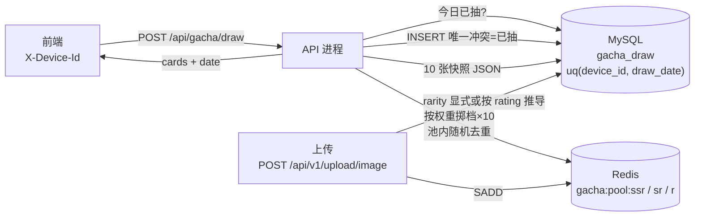

# 抽卡体系设计文档（每日一抽 + 稀有度定档）

| 项目 | 内容 |
|---|---|
| 状态 | 已实现（v1.0，2026-11-18） |
| 日期 | 2026-11-17 |
| 关联文档 | [`photo-system.md`](./photo-system.md)（作者实体 + 评分定档权威）、[`user-system.md`](./user-system.md)、[`docs/API.md`](../API.md)、前端 `girls-rating-web/docs/gacha-design.md` |
| 设计原则 | 沿用「能不加就不加」：一张表 + 三个 Redis Set，无新中间件、无登录、无保底 |
| 已拍板 | 稀有度上传时定档；每日一抽固定 10 张；无保底机制纯娱乐收藏 |

---

## 一、背景与目标

前端要做一个抽卡玩法：**每个设备每天抽一次，一次固定出 10 张卡**，卡牌是图库里的真实图片，稀有度（R / SR / SSR）决定卡面的闪卡视觉效果。纯娱乐收藏向。

### 目标

1. **稀有度落库**：图片在上传时就定档（显式指定或按 rating 推导），抽卡概率由服务端固定权重保证，不依赖库内组成。
2. **每日幂等**：一台设备一天只有一次有效抽取；重复请求**补发当日结果**而不是拒绝，前端刷新/重进零成本恢复。
3. **卡册持久化**：抽过的卡按设备留存，支持分页翻阅与稀有度统计。
4. 概率对外公示（放进 status 响应，抽卡界面惯例）。

### 非目标

- 账号体系绑定（匿名 deviceId 即可，登录体系是给管理端用的）
- 保底 / pity 机制（已拍板砍掉）
- 抽卡货币、交易、卡牌交换
- 严格防刷（deviceId 可清存储重抽，纯娱乐可接受，见 §三.4）

---

## 二、方案概要

一句话：**`rarity` 加列定档，`gacha_draw` 一张表既做每日幂等（唯一索引）也做卡册存储（JSON 快照），抽样走按稀有度拆分的三个 Redis Set，无 Redis 时 DB `ORDER BY RAND()` 兜底。**



存储分工：

| 存什么 | 放哪 | 为什么 |
|---|---|---|
| 图片稀有度 | MySQL `image_resource` 加列 `rarity` | 上传时定档，一劳永逸 |
| 当日抽取记录 + 卡册数据 | MySQL `gacha_draw`，一行一天、`cards` 存 JSON 快照 | **表即记录**：唯一索引天然幂等，卡册直接读快照不用 join 图片表（图片被删后卡册仍在） |
| 抽样池 | Redis 三个 Set（按稀有度） | 复用随机池模式（SRandMemberN + 定时刷新 + DB 兜底） |
| 每日判定 | **不单独存** | `gacha_draw` 里当天有没有行就是答案 |

---

## 三、关键决策

### 3.1 幂等「补发」而不是「拒绝」

`POST /draw` 在当天已抽时不返回 409，而是把当日快照原样返回。理由：

- 前端「恢复今日结果」「判断能否抽」「每日弹窗」三个场景全靠 status/draw 就能闭环，不用维护本地状态。
- 天然幂等，网络重试无副作用。
- 玩家心态友好：看不到「今天已经抽过了」的挫败，看到的是自己的卡。

代价：draw 不是「新的随机事件」，前端不得把补发当新抽展示动画（用 `replayed: true` 标记区分，见 §五）。

### 3.2 每日限制用唯一索引，不用 Redis

`uq_gacha_draw_device_date (device_id, draw_date)`，INSERT 冲突即已抽。与 [`task-system.md`](./task-system.md) 同一思路：**状态只有一份权威**。Redis SETNX 方案是双写，且卡册本来就必须落库，一张表两用，删掉一整类一致性问题。每设备每天一行，量级可忽略，不需要 Redis 缓存。

### 3.3 固定权重抽样，不按库内占比

拍板「稀有度上传时定档」后有个陷阱：若直接等概率抽图，SSR 实际出现率 = 库内 SSR 占比，而库组成不受控（上传 100 张全 R，SSR 就永远绝迹）。所以抽样保留**固定权重**（配置项，默认 R 70 / SR 24 / SSR 6）：先掷档、再从该档池取图。库内档位组成只影响「同一张 SSR 重复出现的频率」，不影响档位概率。

### 3.4 匿名 deviceId 的风险声明

| 风险 | 评估 |
|---|---|
| 清 localStorage / 换浏览器 → 重抽 | 接受。纯娱乐，无经济价值 |
| 伪造 X-Device-Id 刷接口 | 写放大有限（一天一设备一行）；**可选**加固：Redis `INCR gacha:ip:{ip}:{date}` 设每日 IP 上限，默认不启用，留配置项 |
| deviceId 冲突/伪造冒用他人卡册 | 卡册无隐私内容（都是公开图），接受 |

`X-Device-Id` 由前端 `crypto.randomUUID()` 生成、localStorage 持久化；缺失返回 400。

---

## 四、数据模型

### 4.1 Migration `003_gacha.sql`

> `image_resource` 的 `rarity` 列、存量回填与作者表**不在本文档**：照片领域改造（作者实体、评分定档规则的权威定义）见 [`photo-system.md`](./photo-system.md) §三.1 / §四（`002_photo_upgrade.sql`）。本迁移只建抽卡记录表。

```sql
CREATE TABLE IF NOT EXISTS `tb_girls_rating_gacha_draw` (
  `id` BIGINT NOT NULL COMMENT '雪花 ID',
  `device_id` VARCHAR(64) NOT NULL,
  `draw_date` DATE NOT NULL COMMENT '服务器本地日期（时区见配置）',
  `cards` JSON NOT NULL COMMENT '当日抽中的卡牌快照（GachaCardResponse 数组）',
  `created_at` DATETIME(3) NOT NULL DEFAULT CURRENT_TIMESTAMP(3),
  PRIMARY KEY (`id`),
  UNIQUE KEY `uq_gacha_draw_device_date` (`device_id`, `draw_date`)
) ENGINE=InnoDB DEFAULT CHARSET=utf8mb4;
```

模型仍走 GORM `AutoMigrate`（`internal/database/mysql.go`）双保险；迁移文件遵循 docker-compose 初始化约定。

### 4.2 档位与常量

```go
// internal/service/gacha.go
type GachaRarity int8 // 0=R 1=SR 2=SSR；JSON 输出统一转 "R"/"SR"/"SSR"
```

### 4.3 配置（`internal/config`，环境变量注入）

```go
type GachaConfig struct {
    DrawSize      int           // 10，拍板固定
    SSRWeight     float64       // 6
    SRWeight      float64       // 24
    RWeight       float64       // 70
    Timezone      string        // "Asia/Shanghai"，draw_date 按此取日期
    PoolSize      int           // 每档池上限，默认 500
    RefreshInterval time.Duration // 池刷新间隔，复用 RandomConfig 模式
}
```

---

## 五、接口设计

统一响应 `{ msg, code, data }`（`pkg/response`），公开路由直接挂 `Engine`（与 `/api/random` 同级，不走 JWT）：

```
POST /api/gacha/draw        抽卡（幂等补发）
GET  /api/gacha/status      今日状态 + 公示概率 + 累计统计
GET  /api/gacha/collection  卡册分页
```

三个接口都要求请求头 `X-Device-Id`（缺失 → 400）。

### 5.1 卡牌结构（三个接口共用）

```go
type GachaCardResponse struct {
    ResourceURL string `json:"resourceUrl"`
    Width       int    `json:"width"`
    Height      int    `json:"height"`
    Rating      int    `json:"rating"`
    Views       string `json:"views"`
    Rarity      string `json:"rarity"` // "R" | "SR" | "SSR"
    Author      AuthorResponse `json:"author"` // 数据源：AuthorService，见 photo-system.md §五
}
```

快照即此结构的 JSON 数组，读时原样反序列化，**不受后续图片删除/改档影响**。

### 5.2 POST /api/gacha/draw

响应 `data`：

```json
{
  "date": "2026-11-17",
  "replayed": false,
  "cards": [ { ...GachaCardResponse } ],
  "stats": { "totalDays": 3, "totalCards": 30, "ssr": 2, "sr": 7, "r": 21 }
}
```

| 字段 | 说明 |
|---|---|
| `replayed` | true = 当日已抽，本次为补发快照；前端凭此跳过抽取动画，直接进展示态 |
| `stats` | 该设备累计（按快照展开统计） |

错误：400 缺 deviceId；500 抽样/存储失败。**没有 409**（见 §三.1）。

### 5.3 GET /api/gacha/status

```json
{
  "date": "2026-11-17",
  "drawnToday": false,
  "cards": null,
  "probabilities": { "R": 70, "SR": 24, "SSR": 6 },
  "stats": { "totalDays": 3, "totalCards": 30, "ssr": 2, "sr": 7, "r": 21 },
  "pool": { "R": 482, "SR": 96, "SSR": 11 }
}
```

前端开屏调用：`drawnToday=false` 且当日未弹过 → 每日弹窗；`drawnToday=true` → 抽卡页直接进展示态。`pool` 是各档池现存量，供管理页/调试，可缺省。

### 5.4 GET /api/gacha/collection?page=1&pageSize=30

```json
{
  "list": [ { ...GachaCardResponse, "drawDate": "2026-11-16" } ],
  "total": 30,
  "page": 1,
  "pageSize": 30,
  "stats": { "ssr": 2, "sr": 7, "r": 21 }
}
```

实现：按设备取全部 `cards` 快照按 `created_at` 倒序展开，应用层切片分页。行数 = 天数，单设备一年 365 行、三千多张卡，内存切片毫无压力，不值得为此建索引表。

### 5.5 抽卡流程（service 层伪代码）

```go
func Draw(deviceId string) (*DrawResult, error) {
    date := nowIn(tz).Format("2006-01-02")

    // 1. 幂等查：当天已有 → 补发
    if row := repo.FindByDeviceAndDate(deviceId, date); row != nil {
        return replay(row) // replayed: true
    }

    // 2. 掷档抽样：权重掷档 × DrawSize，档内池随机；单次内 resourceUrl 去重
    cards := sampleByWeight(poolR, poolSR, poolSSR, weights, DrawSize)
    // 池空降级：SSR→SR→R 依次回退；全空 → 500（库里没图，画廊同样为空）

    // 3. INSERT（唯一索引兜底并发首抽）
    //    冲突 → 重新读当日行 → 补发（并发双击场景收敛到同一份结果）
    if err := repo.Insert(draw); err != nil { return replay(...) }

    return result(cards, replayed: false)
}
```

### 5.6 抽样池

复用随机池模式：`gacha:pool:ssr / gacha:pool:sr / gacha:pool:r` 三个 Set，成员为 `PhotoRow` JSON（含 rarity / authorId，结构与池 key 版本化见 photo-system.md §4.2）；启动刷新 + `refreshLoop` 定时刷新 + Redis 锁防多实例重复刷新（照抄 `RandomService.RefreshPool`）。Redis 不可用 → 每档 `SELECT ... WHERE rarity=? ORDER BY RAND() LIMIT n` 直接查库。

---

## 六、上传链路改动

上传参数与定档规则的**权威定义在 [`photo-system.md`](./photo-system.md) §5.3 / §四**（`author_id` / `author_name` / `rarity` 参数、find-or-create、阈值派生）。抽卡侧只消费：

1. 上传成功后除加入随机池外，`SADD` 进对应稀有度池（`PhotoRow`，池 key v2）。
2. 池成员携带 `rarity` 与 `authorId`；作者在响应期经 `AuthorService` 解析（photo-system.md §五）。
3. 画廊随机接口响应统一升级为 `PhotoResponse`（含 rarity，photo-system.md §六.1）——抽卡卡面与画廊共用同一结构。

---

## 七、边界与风险

| 场景 | 处理 |
|---|---|
| 某档池为空 | 掷中即降级 SSR→SR→R；全空 → 500（与画廊空态一致） |
| 池图数 < 单档需求 | 池内随机允许重复出现已有图？**否**：单次 10 张内按 `resourceUrl` 去重，不够就用降级档补齐 |
| 时区 / 跨天临界 | `draw_date` 一律按配置时区取服务器当前日期；前端展示该 `date`，不自己算 |
| 并发双击首抽 | 唯一索引冲突 → 转补发（§5.5 步骤 3） |
| Redis 挂 | DB `ORDER BY RAND()` 回退（照抄 RandomService 模式） |
| 图片后来被删 | 卡册/补发读快照，不受影响；画廊可能 404 该图，与现状一致 |
| 刷deviceId重抽 | 接受（§三.4）；可选 IP 限流配置项 |

---

## 八、验收清单

- [ ] `go vet ./...`、`go build ./...`、swagger 注释同步（沿用现有 handler 注释风格）
- [ ] 上传定档与存量回填按 photo-system.md §八验收；本文档侧验证抽样池与 `rarity` 列一致
- [ ] 每日幂等：同 device 同日二次 draw 返回 `replayed=true` 且 cards 与首次一致；并发 20 连发只产生一行
- [ ] 权重正确：mock 池后 1000 次抽样分布 ≈ 6/24/70（±3%）
- [ ] 池空降级链路生效；无 Redis 时 DB 回退可抽
- [ ] 卡册分页/统计与快照一致；缺 X-Device-Id → 400
