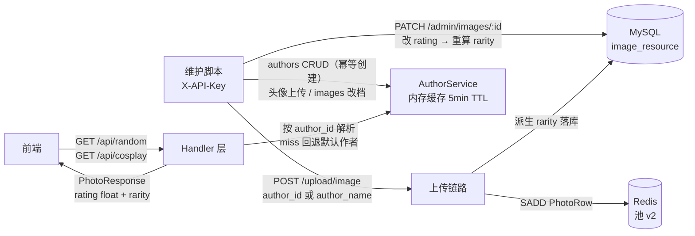

# 照片体系改造设计文档（作者实体化 + 评分定档）

| 项目 | 内容 |
|---|---|
| 状态 | 已实现（v1.0，2026-11-18） |
| 日期 | 2026-11-17 |
| 关联文档 | [`gacha-system.md`](./gacha-system.md)（抽卡，稀有度列的**消费方**）、[`user-system.md`](./user-system.md)、[`docs/API.md`](../API.md) |
| 设计原则 | 能不加就不加：一张 authors 表 + 内存缓存，不引新中间件；本文档是**评分定档规则的唯一权威** |
| 定位 | 照片领域改造（作者、评分、卡片等级）；抽卡只是 rarity 的第一个消费方 |

---

## 一、背景与现状问题

抽卡功能（见 [`gacha-system.md`](./gacha-system.md)）要求「稀有度上传时定档」「卡面展示真实作者」，盘点照片链路发现四个问题：

| # | 现状 | 位置 | 问题 |
|---|---|---|---|
| 1 | 作者硬编码 | `api/handlers/random.go`、`api/handlers/cosplay.go`、`internal/service/random.go` 的 `toRandomItemResponse` | 三处都写死 `"Embrace"` + 固定头像 URL；`author_id` 字段存在但**没有任何作者实体表**，传了也无效 |
| 2 | rating 精度丢失 | `random.go` / `cosplay.go` 响应结构 | DB 是 `decimal(10,1)`，响应却序列化为 `int`，`9.5` 变 `9` |
| 3 | 无卡片等级 | `models/image_resource.go` | rarity 无落库，抽卡无法按档抽样 |
| 4 | 头像在别人家 | `girls-rating-web/public/images/avatars/` | 作者头像是前端仓库静态文件，后端无法管理 |

### 目标

1. **作者实体化**：`authors` 表 + 完整 CRUD 管理接口（API Key 保护，与管理脚本同一信任域，**面向爬虫自动化设计：幂等优先**）+ 上传关联，三处硬编码收敛为一个作者服务。
2. **评分定档统一**：`rating` 是唯一事实来源，`rarity` 为上传时派生（或显式覆盖）的落库字段；全链路（画廊 / 抽卡 / 池）读同一列。
3. **响应统一**：随机、分页、抽卡三个接口共用一套照片响应结构，`rating` 输出恢复浮点。
4. 向后兼容：不改已有字段语义，前端 `CosplayImage` 接口不变（新增字段可选读取）。

### 非目标

- 用户注册成为作者（作者 = 管理员维护的实体，与 `users` 登录体系无关）
- 社会化功能（评论、点赞、关注作者）
- 作者合并（merge）接口——爬虫应**先查后建**避免重复；已产生重复时逐张 `PATCH /admin/images/:id` 改挂后再 DELETE
- 作者多语言简介、主页（字段留白，不实现）

---

## 二、方案概要

一句话：**新增 `authors` 表（seed 默认作者）+ `image_resource` 加 `rarity` 列，作者解析走内存缓存的 `AuthorService`，响应统一 `PhotoResponse`，池成员结构升级并 bump 池 key 版本。**



存储分工：

| 存什么 | 放哪 | 为什么 |
|---|---|---|
| 作者实体 | MySQL `authors`（几个到几十行） | 上传时 find-or-create；改名/换头像一处生效 |
| 作者解析缓存 | 进程内存 map + 5min TTL | 表极小、读极频繁；多实例靠 TTL 收敛，管理接口主动失效本实例 |
| 卡片等级 | `image_resource.rarity` 列 | 上传时定档（本文档权威定义），抽卡按列抽样 |
| 池成员 | Redis Set，`PhotoRow` JSON v2 | 与现有随机池同模式，结构升级靠 key 版本切换 |

---

## 三、数据模型

### 3.1 Migration `002_photo_upgrade.sql`

```sql
-- 作者实体表
CREATE TABLE IF NOT EXISTS `authors` (
  `id` INT UNSIGNED NOT NULL AUTO_INCREMENT,
  `created_at` DATETIME(3) NOT NULL DEFAULT CURRENT_TIMESTAMP(3),
  `updated_at` DATETIME(3) NOT NULL DEFAULT CURRENT_TIMESTAMP(3) ON UPDATE CURRENT_TIMESTAMP(3),
  `name` VARCHAR(50) NOT NULL,
  `avatar` VARCHAR(500) NULL DEFAULT NULL COMMENT '头像 URL（R2 或外链）',
  `deleted_at` DATETIME(3) NULL DEFAULT NULL,
  PRIMARY KEY (`id`),
  UNIQUE KEY `uq_authors_name` (`name`)
) ENGINE=InnoDB DEFAULT CHARSET=utf8mb4;

-- seed 默认作者（与现有硬编码一致，保证升级零感知）
INSERT INTO `authors` (`id`, `name`, `avatar`)
  SELECT 1, 'Embrace', 'https://www.girls-rating.com/images/avatars/avatar1.webp'
  WHERE NOT EXISTS (SELECT 1 FROM `authors` WHERE `id` = 1);

-- 图片表：作者兜底 + 卡片等级列
UPDATE `tb_girls_rating_image_resource` SET `author_id` = 1 WHERE `author_id` IS NULL OR `author_id` = 0;

ALTER TABLE `tb_girls_rating_image_resource`
  ADD COLUMN `rarity` TINYINT NOT NULL DEFAULT 0 COMMENT '卡片等级 0=R 1=SR 2=SSR' AFTER `rating`;

-- 存量定档回填（规则见 §四）
UPDATE `tb_girls_rating_image_resource` SET `rarity` = 2 WHERE `rating` >= 9;
UPDATE `tb_girls_rating_image_resource` SET `rarity` = 1 WHERE `rating` >= 7 AND `rarity` = 0;
```

`rarity` 列与回填 SQL 的**权威定义在本节**；[`gacha-system.md`](./gacha-system.md) §四.1 只保留 `gacha_draw` 表（migration 编号顺延为 `003_gacha.sql`）。

### 3.2 GORM 模型

```go
// internal/models/author.go
type Author struct {
    ID        int            `gorm:"primarykey"`
    CreatedAt time.Time
    UpdatedAt time.Time
    DeletedAt gorm.DeletedAt `gorm:"index"`
    Name      string         `gorm:"type:varchar(50);not null;uniqueIndex"`
    Avatar    string         `gorm:"type:varchar(500);default:null"`
}
```

`ImageResource` 增加对应字段：`Rarity int8`（`gorm:"column:rarity;not null;default:0"`）；`AuthorID` 列已有，语义升级为指向 `authors.id`（不建外键，与仓库现状一致，靠服务层兜底）。

### 3.3 统一响应结构 `PhotoResponse`

```go
type PhotoResponse struct {
    ID          string  `json:"id"`           // random 池无 id 时可省
    ResourceURL string  `json:"resourceUrl"`
    Width       int     `json:"width"`
    Height      int     `json:"height"`
    Rating      float64 `json:"rating"`       // 恢复浮点（见 §六.2 兼容性）
    Views       string  `json:"views"`
    Rarity      string  `json:"rarity"`       // "R" | "SR" | "SSR"
    Author      AuthorResponse `json:"author"` // 形状不变：{ name, avatar }
}
```

`AuthorResponse` 形状保持 `{ name, avatar }`，只是数据来源从硬编码换成作者服务——前端 `CosplayImage.author` 无需改动。

---

## 四、评分与定档规则（权威定义）

### 4.1 规则

- `rating`：`decimal(10,1)`，0.0–10.0，人工在上传/管理时给定（默认 4.0），是唯一输入。
- `rarity`：`TINYINT` 0=R / 1=SR / 2=SSR，**只在写入时派生，读取永不派生**——保证画廊、抽卡、池三处读到的档位恒一致。

| 来源 | 规则 |
|---|---|
| 上传显式指定 `rarity` | 直接落库（覆盖派生） |
| 上传未指定 | 按阈值派生：`rating >= SSRMinRating(9.0) → SSR`；`rating >= SRMinRating(7.0) → SR`；否则 R |
| 管理接口改 `rating`/`rarity` | 重算落库 + 失效缓存 + 同步池 |

阈值走配置（`PhotoConfig.SSRMinRating / SRMinRating`，环境变量注入，与 seed 回填 SQL 的 9 / 7 保持同一默认值）。

### 4.2 池成员结构升级（gotcha）

池 JSON 从 `ImageResourceRow` 换成：

```go
type PhotoRow struct {
    ResourceURL string  `json:"resourceUrl"`
    Width       int     `json:"width"`
    Height      int     `json:"height"`
    Rating      float64 `json:"rating"`
    Views       string  `json:"views"`
    Rarity      int8    `json:"rarity"`    // 0/1/2
    AuthorID    int64   `json:"authorId"`  // 响应期解析作者，池里不冗余 name/avatar
}
```

**池 key 必须版本化**（`poolSetKey` → 带版本后缀，如 `...:v2`）：旧成员 JSON 缺字段，反序列化会得到零值 rarity/authorId，与新数据混池会产生「全部 R 档 + 默认作者」的脏数据。bump 版本 + 首次刷新 RENAME 覆盖，旧 key 设短 TTL 自愈。上传热加路径（`addToRandomPool`）同步改用 `PhotoRow`。

---

## 五、作者体系

### 5.1 AuthorService

```go
func (s *AuthorService) Resolve(ctx context.Context, authorID int64) AuthorResponse
```

- 实现：全表加载进内存 map（几百行上限，GORM 自动过滤软删行），5min TTL 惰性刷新；`Resolve` miss（含作者已软删）时回退**默认作者**（seed 的 id=1），绝不因作者问题 500。
- 失效：管理接口写操作后主动失效本实例缓存；其他实例等 TTL 收敛（作者变更低频，可接受）。

### 5.2 管理接口（新分组 `/api/v1/admin`，复用 `APIKeyAuth` 中间件）

面向自动化工具（爬虫）设计：**创建幂等、查询先行、重试安全**。

| 方法 | 路径 | 说明 |
|---|---|---|
| `GET` | `/api/v1/admin/authors?name=&keyword=&page=&pageSize=` | `name` 精确匹配（**存在性检查**，命中返回单条）；`keyword` 模糊分页列表 |
| `POST` | `/api/v1/admin/authors` | 创建 `{ name, avatar? }`。**幂等**：name 已存在 → `200` + 既有记录 + `existed: true`；新建 → `201`。爬虫崩溃重试不会产生重复 |
| `GET` | `/api/v1/admin/authors/:id` | 详情；不存在/已删 → `404` |
| `PATCH` | `/api/v1/admin/authors/:id` | 更新 `name` / `avatar`；改名撞唯一索引 → `409` |
| `DELETE` | `/api/v1/admin/authors/:id` | **软删除**（同事务把 `name` 改写为 `{name}#del#{id}` 释放唯一槽位，允许重建同名）；响应带 `affectedImages` 计数，被引用图片经 `Resolve` 回退默认作者 |
| `POST` | `/api/v1/admin/authors/:id/avatar` | multipart 头像 → R2 `avatars/` 前缀 → 更新 URL + 失效缓存。也可在创建/更新时直接填外链 URL |
| `PATCH` | `/api/v1/admin/images/:id` | 改 `rating` / `rarity` / `views` / `author_id`：重算定档（§四.1）、清分页缓存、同步随机池与抽卡池成员 |

错误语义统一：`401/403` API Key、`400` 参数、`404` 资源不存在、`409` 名称冲突。写操作后主动失效本实例作者缓存。

### 5.3 上传关联

`POST /api/v1/upload/image` 新增可选参数：

| 参数 | 行为 |
|---|---|
| `author_id` | 已有参数，语义生效：指向 `authors.id`，无效值回退默认作者 |
| `author_name` (+ `author_avatar`) | find-or-create，维护脚本可一把传全，不必先调 authors 接口 |
| `rarity` | 显式定档，缺省按 §四.1 派生 |

优先级：`author_id` > `author_name` > 默认作者。上传响应回显 `rarity` 与 `author`。

> `author_name` find-or-create 是**兜底便捷通道**；爬虫主流程按 §5.4 先查/建作者拿 `id`，再以 `author_id` 上传。

### 5.4 爬虫接入流程（每张图）

```text
1. GET  /api/v1/admin/authors?name={作者名}          → 命中：拿 id；未命中：
2. POST /api/v1/admin/authors { name, avatar }        → 幂等创建，拿 id（崩溃重试安全）
3. 头像二选一：POST /admin/authors/:id/avatar 传二进制，或第 2 步直接给外链 URL
4. POST /api/v1/upload/image (author_id, rating, rarity?)  → 响应回显 rarity
5. 需要修正时 PATCH /api/v1/admin/images/:id
```

作者存在性靠第 1 步查询 + 第 2 步幂等双保险；爬虫侧无需维护本地作者映射表，一切以服务端 `id` 为准。

---

## 六、接口改造清单

### 6.1 逐接口变更

| 接口 | 变更 |
|---|---|
| `GET /api/random` | 响应加 `rarity`；`rating` int→float64；author 从作者服务解析；池 Row 换 `PhotoRow`（§4.2） |
| `GET /api/cosplay` | 同上（author 硬编码删除） |
| `POST /api/v1/upload/image` | 参数/响应见 §5.3 |
| `GET /api/gacha/*`（新） | `GachaCardResponse` 复用 `PhotoResponse` 形状；author 解析同源 |
| `/api/v1/admin/*`（新） | 见 §5.2 |

`internal/service/random.go` 的 `RandomItemResponse`、`cosplay.go` 的 `CosplayItemResponse` 统一替换为（或内嵌）`PhotoResponse`，swagger 注释同步更新。

### 6.2 兼容性

- **新增字段**（`rarity`）向后兼容；`rating` int→float 对前端 `number` 类型无感，仅展示端可能出现小数（前端按需格式化）。
- `author` 形状不变，只换数据源。
- **破坏面仅一个**：池成员 JSON 结构（§4.2），由 key 版本化兜住。

---

## 七、边界与风险

| 场景 | 处理 |
|---|---|
| `author_id` 指向不存在/已软删的作者 | `Resolve` 回退默认作者，不 500 |
| 作者重名 | `uq_authors_name` 唯一索引；POST 创建幂等（§5.2），PATCH 改名冲突返回 `409` |
| 软删后重建同名作者 | 删除时同事务改写 `name = {name}#del#{id}` 释放唯一槽位（§5.2） |
| 头像 URL 失效 | 前端静默降级（现状一致）；R2 上的头像不随图片删除联动 |
| 改档后池未同步 | `PATCH /admin/images/:id` 内同步 SADD/池刷新；池定时刷新兜底 |
| 池 v2 上线瞬间旧池残留 | 版本化 key + 短 TTL 自愈（§4.2） |
| rating 派生阈值与存量回填不一致 | 回填 SQL 与 `PhotoConfig` 默认值同源（9 / 7），改配置需同步评估回填 |

---

## 八、验收清单

- [ ] `go vet ./...`、`go build ./...` 通过；swagger 注释更新（random / cosplay / upload / admin）
- [ ] 三处硬编码作者消失；`author_id` 无效或作者已软删时回退默认作者
- [ ] authors CRUD：`?name=` 精确查询命中/未命中正确；POST 幂等（重复 name 返回既有记录 + `existed:true`）；软删后可重建同名；DELETE 返回 `affectedImages`
- [ ] 上传：`rarity` 显式与派生两条路径落库正确；`author_name` find-or-create 幂等
- [ ] `PATCH /admin/images/:id` 改 rating 后：DB 档位、分页缓存、随机池三者一致
- [ ] random / cosplay 响应：`rating` 浮点、`rarity` 正确、author 来自表
- [ ] 池 key v2 切换后旧 v1 池无引用、无脏数据
- [ ] 前端回归：画廊（热门/最新）正常渲染，作者名/头像展示正常
