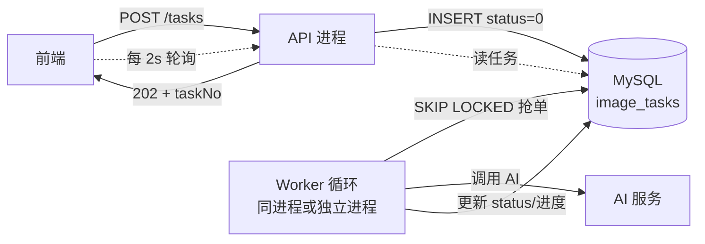
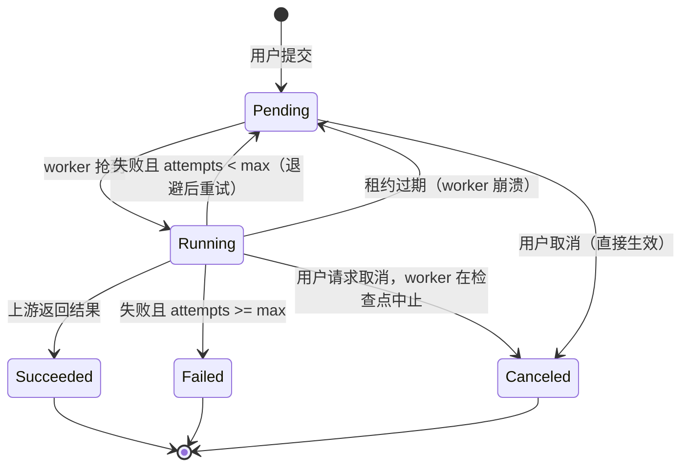

# 用户任务体系设计文档（异步 AI 图片处理）

| 项目 | 内容 |
|---|---|
| 状态 | 草案 v0.1 |
| 日期 | 2026-11-17 |
| 关联文档 | [`user-system.md`](./user-system.md)（用户体系 v0.3：JWT + Redis 白名单）、[`docs/API.md`](../API.md) |
| 设计原则 | 沿用用户体系：**能不加就不加**。队列用 MySQL 而不是引新中间件，一个 worker 循环 + 一张表就能跑 |

---

## 一、背景与目标

AI 处理图片（生成 / 放大 / 去背景）单次耗时从十几秒到几分钟，属于典型的**长耗时同步不可用**场景：HTTP 请求撑不住（网关超时、用户关页面就断了、连接被占满），而且失败后无法重试。

需要一套异步任务体系：**用户提交 → 立刻拿到任务号 → 后台慢慢算 → 用户轮询结果**。

### 目标

1. 提交接口 **200ms 内返回**，不阻塞在 AI 调用上。
2. 任务状态可查、可推进度、可取消、失败可重试。
3. worker 崩溃不会丢任务（租约 + 回收）。
4. 用户只能看到自己的任务。
5. 有每日配额与并发上限，防止单个用户刷爆上游额度。

### 非目标

- 分布式调度、多机房、任务优先级抢占（优先级字段留着，先不用）
- 计费/钱包（配额按"次数"粗算，不做余额）
- 实时推送（先轮询，SSE 留作可选）
- 任务编排（DAG、依赖）——每个任务独立

---

## 二、方案概要

一句话：**`image_tasks` 表既是任务记录也是队列，worker 用 `FOR UPDATE SKIP LOCKED` 抢任务，Redis 只用于每日配额。**



存储分工：

| 存什么 | 放哪 | 为什么 |
|---|---|---|
| 任务状态（唯一权威） | MySQL `image_tasks` | 不能丢；要做列表查询、按用户过滤 |
| 每日配额计数 | Redis | 计数器 + TTL，丢了重算即可 |
| 队列本身 | **不单独存** | 表里 `status=0` 的行就是队列 |

没有 MQ、没有 Redis List 队列、没有定时清理 Redis key 的任务。

---

## 三、关键决策：为什么队列用 MySQL 而不是 Redis

这是本设计最需要解释的一处。

| 维度 | MySQL `SKIP LOCKED`（选定） | Redis List/Stream |
|---|---|---|
| 新增中间件 | 无 | 无（Redis 已有），但引入新的数据一致性面 |
| 一致性 | **任务状态就是队列状态**，天然一致 | 双写：Redis 里排队、MySQL 里记状态，两边可能对不上 |
| 原子抢占 | MySQL 8 原生支持 | `BRPOP` 原子，但"取走即消失"，进程崩溃任务就丢（List 方案）；Stream 需维护 PEL |
| 失败重试 | 改一个字段 | 需要重新投递 + 去重 |
| 延迟 | 轮询间隔（默认 1s） | 接近 0 |
| 运维 | 已有备份/监控 | 需额外监控积压、PEL 堆积 |
| 适合规模 | 每分钟几十到几百个任务 | 每秒上千 |

**结论**：AI 任务本身耗时几十秒以上，1 秒的调度延迟完全被上游耗时淹没；而"Redis 排队 + MySQL 记状态"的双写一致性是这套系统里最容易出 bug 的地方。所以队列就用表，省掉一整类问题。

什么时候该换：任务提交量到每秒几十个、或需要多台 worker 精细调度时，再引 Redis Stream（那时 `image_tasks` 仍是状态权威，只是调度走 Stream）。

---

## 四、数据模型

### 4.1 `image_tasks`

```sql
CREATE TABLE IF NOT EXISTS `image_tasks` (
  `id`               BIGINT UNSIGNED NOT NULL AUTO_INCREMENT,
  `task_no`          VARCHAR(32) NOT NULL COMMENT '对外暴露的任务号（随机），不暴露自增 id',
  `user_id`          INT UNSIGNED NOT NULL COMMENT '提交用户',
  `type`             VARCHAR(32) NOT NULL COMMENT 'generate/upscale/remove_bg',
  `status`           TINYINT NOT NULL DEFAULT 0 COMMENT '0=待处理 1=处理中 2=成功 3=失败 4=已取消',
  `priority`         TINYINT NOT NULL DEFAULT 0 COMMENT '越大越先，预留',
  `prompt`           TEXT NULL DEFAULT NULL COMMENT '生成类任务的提示词',
  `params`           JSON NULL DEFAULT NULL COMMENT '类型相关参数：model/size/seed 等',
  `result_urls`      JSON NULL DEFAULT NULL COMMENT '结果图 R2 相对 key 数组',
  `progress`         TINYINT NOT NULL DEFAULT 0 COMMENT '0-100',
  `stage`            VARCHAR(32) NULL DEFAULT NULL COMMENT '当前阶段文案，给前端展示',
  `attempts`         TINYINT NOT NULL DEFAULT 0 COMMENT '已尝试次数',
  `max_attempts`     TINYINT NOT NULL DEFAULT 3,
  `worker_id`        VARCHAR(64) NULL DEFAULT NULL COMMENT '当前持有租约的 worker',
  `lease_expires_at` DATETIME(3) NULL DEFAULT NULL COMMENT '租约到期时间，过期可被回收',
  `next_run_at`      DATETIME(3) NOT NULL DEFAULT CURRENT_TIMESTAMP(3) COMMENT '最早可执行时间，用于退避重试',
  `cancel_requested` TINYINT NOT NULL DEFAULT 0 COMMENT '用户请求取消',
  `error_code`       VARCHAR(32) NULL DEFAULT NULL COMMENT 'ai_timeout/ai_error/internal/lease_expired',
  `error_msg`        VARCHAR(255) NULL DEFAULT NULL,
  `idempotency_key`  VARCHAR(64) NULL DEFAULT NULL COMMENT '提交幂等键，防连点',
  `created_at`       DATETIME(3) NOT NULL DEFAULT CURRENT_TIMESTAMP(3),
  `started_at`       DATETIME(3) NULL DEFAULT NULL,
  `finished_at`      DATETIME(3) NULL DEFAULT NULL,
  PRIMARY KEY (`id`),
  UNIQUE KEY `uq_task_no` (`task_no`),
  UNIQUE KEY `uq_idem` (`user_id`, `idempotency_key`),
  KEY `idx_claim` (`status`, `next_run_at`, `priority`, `id`),
  KEY `idx_user_time` (`user_id`, `id`),
  KEY `idx_lease` (`status`, `lease_expires_at`)
) ENGINE=InnoDB DEFAULT CHARSET=utf8mb4 COMMENT='AI 图片异步任务';
```

索引说明：

| 索引 | 服务的查询 |
|---|---|
| `uq_task_no` | 按任务号查详情/取消 |
| `uq_idem` | 提交幂等（`idempotency_key` 可为 NULL，MySQL 唯一索引允许多个 NULL，不影响普通提交） |
| `idx_claim` | 抢任务：`WHERE status=0 AND next_run_at<=NOW() ORDER BY priority DESC, id` |
| `idx_user_time` | 我的任务列表：`WHERE user_id=? ORDER BY id DESC` |
| `idx_lease` | 僵尸任务回收：`WHERE status=1 AND lease_expires_at<NOW()` |

**为什么用 `task_no` 而不是自增 id 对外**：自增 id 可被遍历（`/tasks/1`、`/tasks/2`…），即使加了 `user_id` 过滤，也不该给攻击者一个可枚举的入口。`task_no` 用 16 字节随机 hex（32 字符），配合 `WHERE task_no=? AND user_id=?` 双重约束。

### 4.2 状态机



**终态**：`Succeeded` / `Failed` / `Canceled`。终态任务不再被抢。

---

## 五、任务生命周期

### 5.1 抢占（核心 SQL）

worker 每轮在**一个事务**里做三件事，`SKIP LOCKED` 保证多 worker 并发时不会抢到同一条：

```sql
START TRANSACTION;

SELECT id FROM image_tasks
 WHERE status = 0
   AND next_run_at <= NOW(3)
 ORDER BY priority DESC, id ASC
 LIMIT 1
 FOR UPDATE SKIP LOCKED;

UPDATE image_tasks
   SET status = 1,
       worker_id = ?,
       attempts = attempts + 1,
       lease_expires_at = NOW(3) + INTERVAL 90 SECOND,
       started_at = COALESCE(started_at, NOW(3)),
       stage = '处理中'
 WHERE id = ?;

COMMIT;
```

GORM 写法：

```go
tx.Clauses(clause.Locking{Strength: "UPDATE", Options: "SKIP LOCKED"}).
    Where("status = 0 AND next_run_at <= NOW(3)").
    Order("priority DESC, id ASC").
    First(&task)
```

`SKIP LOCKED` 必须放在显式事务里——否则锁立即释放，等于没锁。

### 5.2 租约与僵尸回收

worker 抢到任务后拿一个 **90 秒租约**（`lease_expires_at`），执行期间每 30 秒续一次租：

```sql
UPDATE image_tasks SET lease_expires_at = NOW(3) + INTERVAL 90 SECOND
 WHERE id = ? AND worker_id = ?
```

另起一个回收协程，每 30 秒扫一次：

```sql
-- 租约过期且还有重试次数 → 放回队列
UPDATE image_tasks
   SET status = 0, worker_id = NULL, lease_expires_at = NULL,
       next_run_at = NOW(3) + INTERVAL 10 SECOND,
       error_code = 'lease_expired'
 WHERE status = 1 AND lease_expires_at < NOW(3) AND attempts < max_attempts;

-- 没次数了 → 终态失败
UPDATE image_tasks
   SET status = 3, finished_at = NOW(3),
       error_code = 'lease_expired', error_msg = 'worker 超时未完成'
 WHERE status = 1 AND lease_expires_at < NOW(3) AND attempts >= max_attempts;
```

没有租约的话，worker 被 kill -9 之后，那条任务会永远卡在 `running`，用户等到天荒地老。**这是异步任务体系最容易漏、也最必须做的一块。**

### 5.3 失败重试与退避

上游失败时不是立刻重排（会瞬间打爆上游），而是写 `next_run_at` 做指数退避：

```
delay = min(2^attempts * 10s, 5min)   -- 20s, 40s, 80s...
```

```sql
UPDATE image_tasks
   SET status = 0, next_run_at = NOW(3) + INTERVAL ? SECOND,
       worker_id = NULL, lease_expires_at = NULL,
       error_code = ?, error_msg = ?
 WHERE id = ? AND worker_id = ?
```

`AND worker_id = ?` 是必要的：防止一个已经被回收、被别的 worker 接手的任务，被上一任 worker 的迟到回调覆盖状态（ABA 问题）。

### 5.4 取消

| 任务状态 | 行为 |
|---|---|
| `pending` | 直接 `status=4`，立刻生效 |
| `running` | 置 `cancel_requested=1`，worker 在下一个检查点中止（`ctx` 取消），然后 `status=4` |
| 终态 | 返回 200 但不变更（幂等） |

worker 的检查点：在进度上报时顺带查一次 `cancel_requested`（节流到每 5 秒一次），命中就 `context.CancelFunc()` 打断上游调用。不追求"立刻停止"——上游可能本来就不支持中途取消，尽力而为即可。

---

## 六、Worker 设计

### 6.1 进程形态

**默认与 API 同进程**，用配置开关控制：

```
WORKER_ENABLED=true   # 部署时如果 API 要独立扩容，把 worker 关掉，另起一个只跑 worker 的容器
```

同一份代码提供两个入口：

```
cmd/main.go     # API（读 WORKER_ENABLED 决定是否顺带起 worker）
cmd/worker/main.go   # 只跑 worker（可选，M3 再拆）
```

同进程 + `SKIP LOCKED` 的语义是安全的：即使起了多个副本，也不会重复执行同一个任务。所以小系统不需要为了"正确性"提前拆进程。

### 6.2 循环

```go
func (w *Worker) Run(ctx context.Context) {
    var wg sync.WaitGroup
    for i := 0; i < w.concurrency; i++ {
        wg.Add(1)
        go func(id int) {
            defer wg.Done()
            w.loop(ctx, id)   // 各自独立的 workerID
        }(i)
    }

    wg.Add(1)
    go func() { defer wg.Done(); w.reapLoop(ctx) }()   // 僵尸回收

    wg.Wait()   // ctx 取消后等所有 goroutine 收尾
}

func (w *Worker) loop(ctx context.Context, idx int) {
    ticker := time.NewTicker(w.pollInterval)   // 默认 1s
    defer ticker.Stop()
    for {
        select {
        case <-ctx.Done():
            return
        case <-ticker.C:
            task, err := w.claim(ctx)          // 抢不到就下一轮
            if err != nil || task == nil {
                continue
            }
            w.execute(ctx, task)               // 内含 lease 续租协程
        }
    }
}
```

要点：

- **并发度就是 goroutine 数**，每个 goroutine 同时只处理一个任务。AI 调用是 IO 等待，goroutine 便宜，`WORKER_CONCURRENCY=2~4` 足够。
- **抢不到就 `continue`**，不要 sleep 叠加。
- **`execute` 内部**：起一个 `time.AfterFunc` 每 30s 续租 → 用 `context.WithTimeout`（默认 10 分钟）调 Provider → 按结果写终态 → 停掉续租。续租协程必须 `defer` 停掉，否则任务结束后还会续租幽灵租约。

### 6.3 优雅停机

收到 SIGTERM 时：

1. 取消根 `ctx` → 所有 worker 停止抢新任务；
2. 正在执行的任务会被 `ctx` 打断，随后**主动释放**（`status=0, worker_id=NULL, lease_expires_at=NULL`），而不是等租约自然过期——这样重启后任务立刻能被接走，不用白等 90 秒。

---

## 七、AI Provider 抽象

worker 不关心具体是哪个 AI 服务，只认一个接口：

```go
// pkg/ai/provider.go
type Request struct {
    Type   string          // generate/upscale/remove_bg
    Prompt string
    Params json.RawMessage
}

type Provider interface {
    Name() string
    // Run 同步执行直到出结果；onProgress 用于上报进度（0-100 + 阶段文案）
    Run(ctx context.Context, req Request, onProgress func(progress int, stage string)) ([]string, error)
}
```

- `Run` 返回 R2 相对 key 数组（与现有 `resource_url` 存相对路径的约定一致，出参时再拼 `S3_HOST`）。
- `onProgress` 由 worker 注入，节流后写库；Provider 本身不碰数据库。
- 不同上游的实现差异被关在 `pkg/ai/<vendor>.go` 里。

**两种上游形态**：

| 上游形态 | 实现方式 | 适用 |
|---|---|---|
| 同步返回（一个 HTTP 请求等到出图） | `Run` 里阻塞调用，`ctx` 超时控制 | 默认，最简单 |
| 异步（提交后拿 job id，需轮询） | `Run` 内部循环轮询上游，仍对外表现为同步 | 上游支持时 |

第二种会占住一个 goroutine 直到出结果——在 `concurrency=2` 的小系统里完全可以接受。真要提升吞吐再改"提交/轮询两段式"（加 `external_job_id` 字段），暂不设计。

---

## 八、配额与限流

两道闸门，都在**创建任务时**检查：

| 限制 | 实现 | 默认 |
|---|---|---|
| 每日次数 | Redis `{env}:quota:task:{user_id}:{yyyymmdd}` `INCR`，首次设 TTL 48h | 20 次/天 |
| 同时进行中 | `SELECT COUNT(*) FROM image_tasks WHERE user_id=? AND status IN (0,1)` | 2 个 |

超额返回 `429 RATE_LIMITED`，`data.retryAfter` / `data.remaining=0`。

**失败返还**：任务进入终态 `Failed` 时 `DECR` 配额（Redis key 还在 TTL 内才减），因为上游失败不是用户的错。只做这一条，不做"取消返还"（避免用户刷取消钻空子）。

进行中数量用 DB 查而不是 Redis 计数：任务状态本来就在库里，多存一份反而要维护同步。`idx_user_time` 上前缀扫描，单用户几十条记录，开销可忽略。

---

## 九、接口设计

| Method | Path | 认证 | 说明 |
|---|---|---|---|
| POST | `/api/v1/tasks` | JWT | 创建任务，`202 Accepted` |
| GET | `/api/v1/tasks/:taskNo` | JWT | 查单个任务（轮询用） |
| GET | `/api/v1/tasks` | JWT | 我的任务列表（分页） |
| POST | `/api/v1/tasks/:taskNo/cancel` | JWT | 取消 |
| GET | `/api/v1/tasks/quota` | JWT | 剩余次数 / 进行中数量 |

统一前缀 `/api/v1`，鉴权沿用用户体系的 Redis 白名单（`EXISTS auth:sess:{uid}:{jti}`）。所有查询强制 `WHERE user_id = claims.user_id`。

### 9.1 创建任务

```json
POST /api/v1/tasks
{
  "type": "generate",
  "prompt": "a girl standing on a rooftop at sunset",
  "params": { "model": "sd-xl", "width": 1024, "height": 1536, "count": 2 },
  "idempotencyKey": "8f3a1c2b-..."
}
```

`202`

```json
{
  "msg": "success",
  "code": 202,
  "data": {
    "taskNo": "e3b0c44298fc1c149afbf4c8996fb924",
    "type": "generate",
    "status": "pending",
    "progress": 0,
    "stage": "排队中",
    "createdAt": "2026-11-17T22:32:23+08:00",
    "pollAfterMs": 2000
  }
}
```

- `idempotencyKey` 可选。传了的话，同一用户重复提交（连点、网络重试）会返回**已存在的任务**而不是新建，靠 `uq_idem` 唯一索引兜底（先查后插 + 捕获 1062）。不传就正常新建。
- `202` 而不是 `200`：语义是"已受理，未完成"。

### 9.2 查询任务

```json
GET /api/v1/tasks/e3b0c44298fc1c149afbf4c8996fb924
```

```json
{
  "msg": "success",
  "code": 200,
  "data": {
    "taskNo": "e3b0c44298fc1c149afbf4c8996fb924",
    "type": "generate",
    "status": "running",
    "progress": 45,
    "stage": "生成中",
    "resultUrls": [],
    "errorCode": null,
    "errorMsg": null,
    "createdAt": "2026-11-17T22:32:23+08:00",
    "startedAt": "2026-11-17T22:32:25+08:00",
    "finishedAt": null,
    "pollAfterMs": 3000
  }
}
```

成功时：

```json
{
  "status": "succeeded",
  "progress": 100,
  "stage": "已完成",
  "resultUrls": [
    "https://static.example.com/generated/2026/11/17/abc123.png",
    "https://static.example.com/generated/2026/11/17/def456.png"
  ],
  "pollAfterMs": null
}
```

失败时：`status: "failed"`，带 `errorCode`（`ai_timeout` / `ai_error` / `internal` / `lease_expired`）与用户可读的 `errorMsg`。

**状态用字符串而不是数字**：前端判断 `status === 'succeeded'` 远比记 0/1/2/3 靠谱，DB 内部仍存 `TINYINT` 便于索引和统计。

**`pollAfterMs`** 是服务端下发的建议轮询间隔：排队中 2s、生成中 3s、终态 null（停止轮询）。把节奏控制权放在后端，以后调整不用发前端。

### 9.3 任务列表

```
GET /api/v1/tasks?status=succeeded&page=1&pageSize=10
```

沿用现有分页响应结构（`totalCount` / `totalPage` / `pageSize` / `currPage` / `list`），排序用 `ORDER BY id DESC`。

> 用 `id` 排序而不是 `created_at`：自增主键天然唯一且单调，不会出现 `/api/cosplay` 那个"同一秒的多条记录在翻页时重复/漏出"的问题。

### 9.4 错误码

| bizCode | HTTP | 说明 |
|---|---|---|
| `VALIDATION_FAILED` | 400 | type 不支持、prompt 超长、params 非法 |
| `TASK_NOT_FOUND` | 404 | 任务不存在**或不属于当前用户**（不区分，避免探测） |
| `TASK_NOT_CANCELABLE` | 409 | 已终态 |
| `QUOTA_EXCEEDED` | 429 | 当日次数用完 |
| `TOO_MANY_INFLIGHT` | 429 | 进行中任务已达上限 |

---

## 十、前端交互

### 10.1 轮询（默认方案）

```
提交 → 202 + taskNo
  ↓
每 pollAfterMs 拉一次 GET /tasks/{taskNo}
  ↓
status 进入终态（succeeded/failed/canceled）→ 停止轮询，渲染结果
```

细节：

- 页面切到后台（`document.hidden`）时暂停轮询，切回来立即拉一次；避免用户开着标签页空转。
- 连续失败退避：`pollAfterMs * 2`，上限 15s。
- 不要用固定 `setInterval`，要用"上一次请求完成后再 setTimeout"，避免请求堆叠。

### 10.2 SSE（可选，M2 以后）

任务普遍超过 30 秒时，轮询会显得吵。可加 `GET /api/v1/tasks/:taskNo/stream`（`text/event-stream`）推送状态变更。但这需要服务端维护长连接（Gin 里要小心超时与反代），**先不做**，轮询在几十个用户的规模下完全够。

---

## 十一、可观测性

| 项 | 做法 |
|---|---|
| 任务日志 | 每个任务结束时一行结构化日志：`task_no`、`user_id`、`type`、`attempts`、`duration_ms`、`status`、`error_code` |
| 队列积压 | `SELECT COUNT(*) WHERE status=0`；超过阈值（如 100）打 warn 日志 |
| 成功率 | 由日志聚合，暂不做看板 |
| 慢任务 | `duration_ms > 300s` 打 warn，便于发现上游变慢 |
| 僵尸回收 | 每次回收打一条 warn，带 `task_no` 与 `attempts` |

不做 Prometheus 接入（项目目前没有指标体系，为一个模块单独引 opentelemetry 不划算）。

---

## 十二、配置

| 变量 | 说明 | 默认 |
|---|---|---|
| `WORKER_ENABLED` | 是否在 API 进程内启动 worker | `true` |
| `WORKER_CONCURRENCY` | 并发任务数（goroutine） | `2` |
| `WORKER_POLL_INTERVAL_MS` | 抢任务轮询间隔 | `1000` |
| `WORKER_TASK_TIMEOUT_SECONDS` | 单任务超时 | `600` |
| `WORKER_LEASE_SECONDS` | 租约时长 | `90` |
| `WORKER_MAX_ATTEMPTS` | 最大尝试次数 | `3` |
| `TASK_QUOTA_PER_DAY` | 每用户每日任务数 | `20` |
| `TASK_MAX_INFLIGHT` | 每用户同时进行中上限 | `2` |
| `AI_PROVIDER` | 使用哪个 Provider 实现 | `mock` |
| `AI_BASE_URL` / `AI_API_KEY` | 上游凭证 | - |

`AI_PROVIDER=mock` 时返回一张固定图片 + 模拟 10~30 秒延迟，**没有上游凭证也能把整条链路跑通**，这是本地开发和压测的前提。

---

## 十三、代码改动清单

| 层 | 文件 | 变更 |
|---|---|---|
| 迁移 | `migrations/003_image_tasks.sql` | 新增表 |
| models | `internal/models/image_task.go` | `ImageTask` 实体 + 状态常量 |
| repository | `internal/repository/image_task.go` | `Create` / `GetByNo` / `ListByUser` / `Claim` / `RenewLease` / `Requeue` / `Finish` / `ReapExpired` / `CountInflight` |
| service | `internal/service/task.go` | 创建（配额 + 幂等）、查询、列表、取消 |
| service | `internal/service/quota.go` | Redis 每日配额（约 40 行） |
| worker | `internal/worker/worker.go` | 循环、抢单、续租、回收、优雅停机 |
| pkg | `pkg/ai/provider.go` | `Provider` 接口 + `Request` |
| pkg | `pkg/ai/mock.go` | 本地模拟实现（**先写这个**） |
| handlers | `api/handlers/task.go` | 5 个接口 |
| router | `api/handlers/server.go` | 注册 `/api/v1/tasks/*` |
| main | `cmd/main.go` | `WORKER_ENABLED` 时启动 worker，接 SIGTERM 优雅停机 |
| 文档 | `docs/API.md` | 同步接口契约 |

**不引第三方依赖**：队列用 GORM 事务 + `clause.Locking`，配额用现有 go-redis，taskNo 用 `crypto/rand`。

---

## 十四、数据保留

| 数据 | 策略 |
|---|---|
| 终态任务记录 | 保留 90 天，之后物理删除：`DELETE FROM image_tasks WHERE status IN (2,3,4) AND finished_at < NOW() - INTERVAL 90 DAY LIMIT 1000;` |
| 结果图片（R2） | **不自动删除**。用户可能已收藏/分享，误删代价高 |
| 进行中任务 | 永不删除 |

清理挂在维护脚本里，和上传脚本同一入口，每日一次。若将来要做"用户删除任务"，那才考虑同步删 R2 对象。

---

## 十五、测试

| 范围 | 用例 |
|---|---|
| 抢单 | 两个 worker 并发 `Claim`，同一任务只会被一个拿到（需要真实 MySQL，`sqlmock` 测不出来） |
| 租约 | 手动把 `lease_expires_at` 设为过去 → 回收协程把任务放回 `pending` 且 `attempts+1` |
| 重试 | `attempts >= max` 时直接终态 `failed(lease_expired)` |
| 幂等 | 同一 `idempotencyKey` 提交两次 → 返回同一个 `taskNo`，库里只有一条 |
| 配额 | 第 21 次提交 429；失败任务返还后可以再提交 |
| 取消 | `pending` 取消立即生效；`running` 取消后 worker 中止并置 `canceled` |
| 越权 | A 用户查 B 用户的 `taskNo` → 404 |
| 停机 | 发 SIGTERM，正在跑的任务被释放回 `pending`，重启后能被再次执行 |

用 `AI_PROVIDER=mock` + 真实本地 MySQL/Redis 做集成测试。

---

## 十六、里程碑

| 阶段 | 内容 |
|---|---|
| M1 | 表 + mock Provider + 提交/查询接口 + 内嵌 worker 跑通「提交 → 出图」 |
| M2 | 租约/回收/重试/取消/配额/幂等 + 列表接口 |
| M3 | 接真实 AI 上游；视情况拆出 `cmd/worker`、加 SSE |

---

## 附录 A：已经想清楚、不要重复讨论的点

| 选项 | 结论 | 理由 |
|---|---|---|
| Redis List 当队列 | 不做 | 双写一致性成本 > 1 秒延迟收益；List "取走即消失"，进程崩溃丢任务 |
| Redis Stream | 暂不做 | 需要维护 PEL、ACK、消费组；当前量级用不上 |
| 用 cron 扫表逐个同步执行 | 不做 | 并发不可控，一个慢任务会拖住整批 |
| worker 独立进程（一开始就拆） | 不做 | 同进程 + `SKIP LOCKED` 语义正确，省一套部署 |
| 任务优先级抢占 | 不做 | 字段留着，先都填 0 |
| SSE / WebSocket 推送 | M2 之后再说 | 轮询足够，长连接在反代下要额外调超时 |
| 任务分片/分库 | 不做 | 单表足够；真要分，按 `user_id` 哈希 |
| 上游回调 webhook | 不做 | 需要公网可达 + 签名校验，收益不值 |

**升级信号**（出现任一条再动架构）：

1. 提交量 > 每秒 20 个，或 worker 数量 > 5 台 → 考虑 Redis Stream 调度
2. 队列积压长期 > 500 → 加 worker 副本或提高并发
3. 用户抱怨轮询太吵 / 任务普遍 > 2 分钟 → 上 SSE
4. 单表 > 1000 万行 → 按 `user_id` 分表或归档到历史表

---

## 附录 B：与用户体系的衔接

- 任务的 `user_id` 一律取自 JWT claims，不接受 body 传入。
- 所有查询（详情/列表/取消）都带 `WHERE user_id = ?`，越权统一返回 404 而不是 403（不暴露"任务存在但不属于你"）。
- 鉴权链路沿用 `user-system.md` §4.2 的 Redis 白名单：用户被踢下线时，其提交的任务**不中断**（后台继续跑完），但拿不到结果——这是合理的，因为资源已消耗。
- 若将来生成图要进公共列表，复用 `UploadService` 的落库逻辑（写 `tb_girls_rating_image_resource` + 清分页缓存 + 入随机池），届时单独决策。
